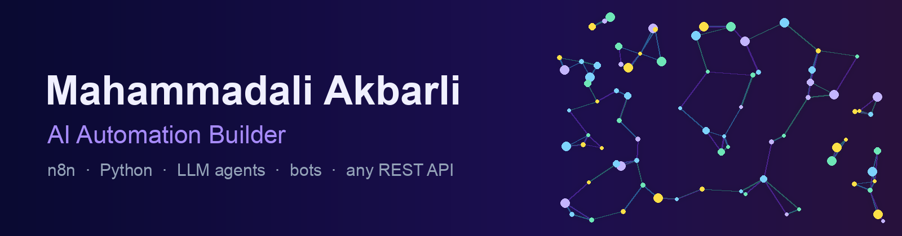

# Hi, I'm Mahammadali

**AI automation builder.** I connect LLMs, APIs and everyday tools into workflows that run on their own and are easy to check.

I'm an engineer by training. AI has become a big part of my life, and I learned automation and AI on my own through courses, documentation and a lot of building. I like turning messy manual work into small, reliable systems.

## What I build

- **AI agents and multi-model pipelines**: several LLMs split a task, check each other and report back
- **Workflow automation** with n8n and Python: webhooks, paged APIs, de-duplicated syncs, retries and alerts
- **Bots and browser automation**: WhatsApp and Telegram bots, Playwright for sites without an API
- **Document tools**: OCR, PDF parsing, automatic reports
- **Integrations**: any REST API or webhook your team already uses

## Featured projects

<table>
<tr>
<td width="50%" valign="top">

 <b><a href="https://github.com/Zeusmma/lead-radar">lead-radar</a></b> Lead finding and outreach tool: scoring from public data, a demo site per business, messages in the business's own language, daily limits, human click to send.
</td>
<td width="50%" valign="top">

 <b><a href="https://github.com/Zeusmma/multi-llm-orchestrator">multi-llm-orchestrator</a></b> Fans tasks out to several LLM backends, routes by difficulty with quota-aware fallback, writes a comparison report.
</td>
</tr>
<tr>
<td width="50%" valign="top">

 <b><a href="https://github.com/Zeusmma/gumroad-airtable-n8n">gumroad-airtable-n8n</a></b> n8n workflow: live webhook plus paged backfill, upserts keyed on a stable ID, unit-tested.
</td>
<td width="50%" valign="top">

 <b><a href="https://github.com/Zeusmma/obsidian-ai-second-brain">obsidian-ai-second-brain</a></b> Obsidian setup for an AI-assisted second brain, with a plugin that shows your notes as a nervous system in 18 views.
</td>
</tr>
</table>

## Stack

LLM APIs (OpenAI-compatible and Anthropic-compatible), REST APIs and webhooks, OCR, Playwright, shell scripting. Security background (eJPT).

## GitHub stats

## Working with me

Open to remote AI automation work: contracts, part-time or full-time. Flexible hours with overlap for US and European teams. A short paid test task is a good way to start.

[LinkedIn](https://www.linkedin.com/in/mahammadali-akbarli)
